# Insurance claim fraud detection: a leak-free, statistically honest benchmark

[](https://github.com/fleury-fcn/prediction-sinistres-machine-learning-/actions/workflows/ci.yml)


> **Résumé (FR).** Détection de fraude sur 1 000 sinistres automobiles publics. Neuf modèles
> (régressions logistiques, forêts, boostings, CatBoost, MLP PyTorch, stacking) sont optimisés
> avec le même budget Optuna, comparés par validation croisée répétée et tests statistiques,
> puis évalués une seule fois sur un jeu de test tenu à l'écart. Le meilleur modèle atteint une
> ROC-AUC de 0,84 [0,77 ; 0,90] et une PR-AUC de 0,55 [0,46 ; 0,71] sur le test (contre 0,50 de
> ROC-AUC pour la version précédente du projet), mais **aucun modèle n'est significativement
> meilleur que les autres** et le signal repose presque entièrement sur deux variables. Un jeu
> **synthétique** de 500 000 lignes sert uniquement aux tests de montée en charge : il n'apporte
> aucune information nouvelle sur la fraude réelle, ce que le protocole TSTR confirme.

**In three lines.** On the public 1,000-claim fraud dataset, nine models tuned with an
identical Optuna budget all land within a few PR-AUC points of each other; the best one
(CatBoost, chosen on cross-validation) reaches **ROC-AUC 0.84 and PR-AUC 0.55 on the untouched
test set**, cuts the expected cost per claim by **32 %** versus investigating every claim under
the stated cost hypotheses, and is **not significantly better** than a tuned random forest,
gradient boosting or elastic-net logistic regression.

## Main results (real data, hold-out test set of 200 claims, 49 frauds)

| Model | CV PR-AUC (mean ± sd) | Test PR-AUC [95% CI] | Test ROC-AUC [95% CI] | F1 | Recall | Precision | MCC | Brier | Cost / claim (USD) |
|---|---|---|---|---|---|---|---|---|---|
| **CatBoost** (reference, exported) | 0.707 ± 0.054 | 0.553 [0.463; 0.708] | 0.839 [0.769; 0.902] | 0.730 | 0.857 | 0.636 | 0.639 | 0.124 | 680 |
| Stacking (top-3 + logistic meta) | 0.704 ± 0.062 | 0.588 [0.482; 0.721] | 0.827 [0.747; 0.895] | 0.730 | 0.857 | 0.636 | 0.639 | 0.126 | 680 |
| Random forest | 0.701 ± 0.061 | 0.600 [0.489; 0.736] | 0.827 [0.748; 0.897] | 0.718 | 0.857 | 0.618 | 0.622 | 0.123 | 690 |
| Gradient boosting (sklearn) | 0.695 ± 0.057 | 0.592 [0.483; 0.726] | 0.837 [0.766; 0.899] | 0.730 | 0.857 | 0.636 | 0.639 | 0.120 | 680 |
| Logistic regression (elastic net) | 0.693 ± 0.054 | 0.524 [0.434; 0.669] | 0.818 [0.743; 0.884] | 0.609 | 0.857 | 0.472 | 0.472 | 0.152 | 795 |
| XGBoost | 0.683 ± 0.059 | 0.512 [0.432; 0.657] | 0.832 [0.763; 0.894] | 0.726 | 0.837 | 0.641 | 0.631 | 0.143 | 720 |
| MLP + embeddings (PyTorch) | 0.668 ± 0.062 | 0.537 [0.447; 0.682] | 0.840 [0.777; 0.896] | 0.621 | 0.837 | 0.494 | 0.488 | 0.146 | 815 |
| LightGBM | 0.659 ± 0.058 | 0.520 [0.439; 0.665] | 0.830 [0.753; 0.897] | 0.707 | 0.837 | 0.612 | 0.606 | 0.140 | 735 |
| Logistic regression (no penalty) | 0.629 ± 0.065 | 0.499 [0.402; 0.646] | 0.771 [0.686; 0.844] | 0.503 | 0.735 | 0.383 | 0.302 | 0.175 | 1,120 |

Rows are sorted by **cross-validated** PR-AUC (5 × 5 repeated CV on the 800 training claims),
which is how the reference model was chosen; the test set was used once, at the end. F1,
recall, precision, MCC and cost use each model's cost-optimal threshold, chosen on its training
out-of-fold predictions. Brackets are 95 % stratified-bootstrap intervals (2,000 resamples).
Trivial policies on the same test set: *investigate nothing* = 2,450 USD/claim, *investigate
every claim* = 1,000 USD/claim. Fraud prevalence (the PR-AUC of a random model) is 0.245.

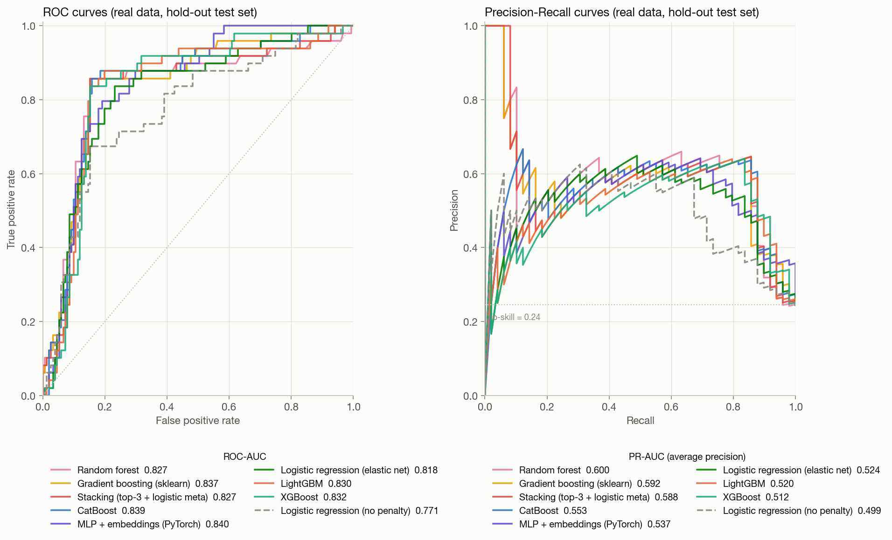

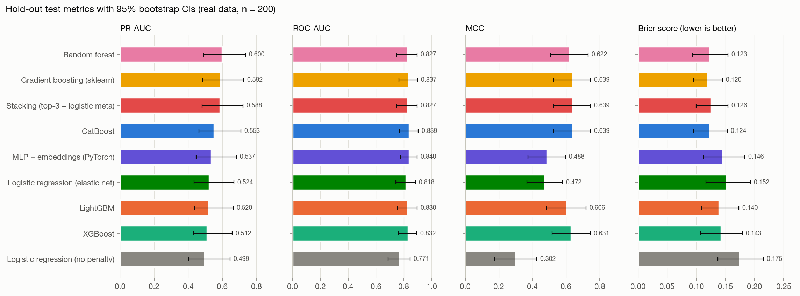

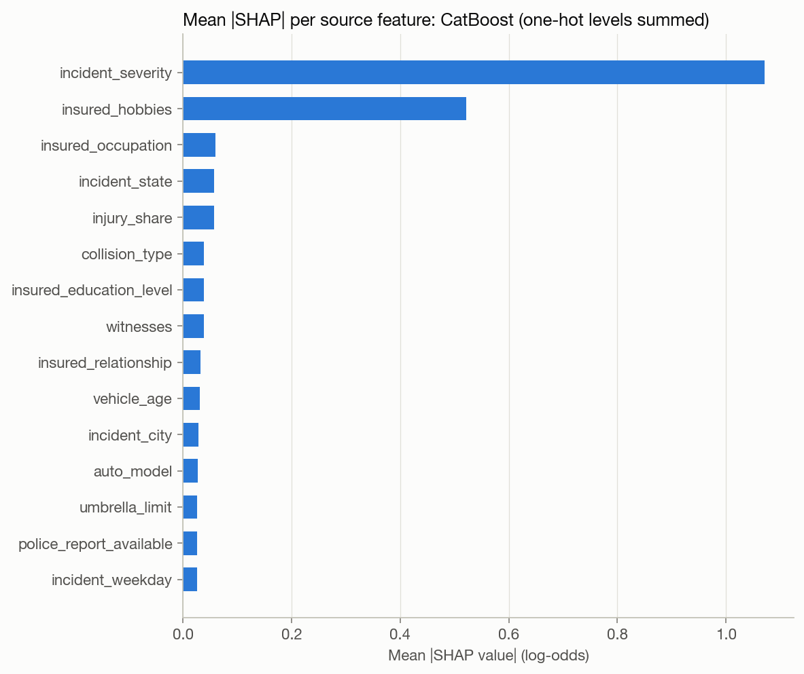

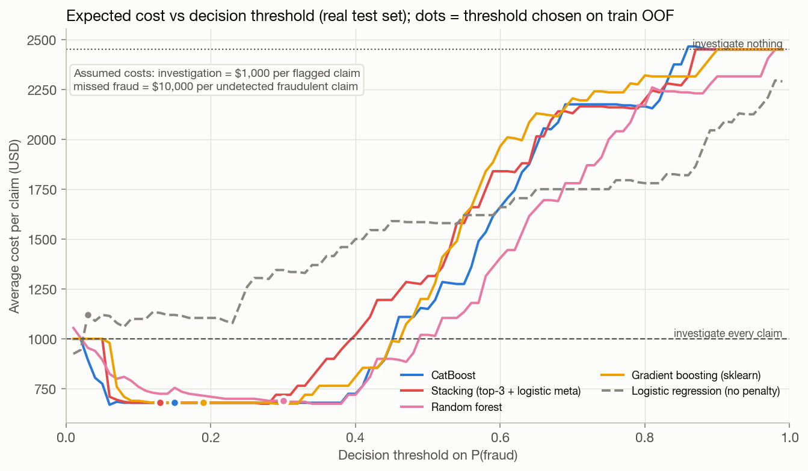

### What the numbers say

* **Large gain over the previous version, small differences between models.** The former
  4-variable pipeline scored ROC-AUC ≈ 0.50 (chance). Using every relevant column brings all
  tuned models to ROC-AUC 0.82–0.84 on the test set. Between models, differences are smaller
  than the uncertainty: the Nadeau–Bengio corrected t-test on the 25 CV folds and the paired
  bootstrap on the test set give no significant difference with CatBoost after Holm correction
  (smallest adjusted p = 0.22). Before correction, only LightGBM (p = 0.03) and the
  unpenalised logistic regression (p = 0.04) look worse on CV.
* **CV vs test.** Test PR-AUC (0.50–0.60) is below CV PR-AUC (0.63–0.71). With 49 positive
  test claims the bootstrap interval of a single PR-AUC spans ±0.1, so the gap is compatible
  with sampling noise; the CV figures (200 frauds × 5 repeats) are the more stable estimate.
* **Decision quality.** At the chosen thresholds the tree ensembles catch 86 % of frauds with
  64 % precision. McNemar tests detect real differences in errors at those operating points
  (CatBoost right / elastic net wrong on 26 claims vs 3 the other way, p < 0.001), mostly
  because the linear models and the MLP flag more legitimate claims at their own
  cost-optimal thresholds.
* **The deep-learning model does not help here.** The MLP with categorical embeddings is
  competitive in test ROC-AUC (0.84) but has the second-lowest CV PR-AUC and the highest CV
  Brier score among the tuned models. With 640 training rows per fold this is expected; it is kept as an
  honest comparison point, not as the recommended model.
* **Two features carry the signal** (see interpretation). Removing `insured_hobbies` drops CV
  PR-AUC from 0.71 to 0.50; removing `incident_severity` drops it to 0.54.

---

## Table of contents

1. [Problem and data](#problem-and-data)
2. [Methodology](#methodology)
3. [Results in detail](#results-in-detail)
4. [Synthetic data: scale and robustness only](#synthetic-data-scale-and-robustness-only)
5. [Interpretation](#interpretation)
6. [Limitations and honest notes](#limitations-and-honest-notes)
7. [Reproduce](#reproduce)
8. [Repository structure](#repository-structure)
9. [Serving the model](#serving-the-model)
10. [Next steps](#next-steps)

## Problem and data

The task is to score an **already filed** automobile claim for fraud, so that an insurer can
decide which claims to send to investigation. The public dataset by Derrick Mwiti
(<https://github.com/mwitiderrick/insurancedata>) has 1,000 claims, 39 columns and 247
frauds (24.7 %): policy (tenure, state, deductible, premium, umbrella limit, combined single
limit), insured person (age, sex, education, occupation, hobbies, relationship, capital gains
and losses), incident (date, type, collision type, severity, authorities contacted, state,
city, hour, vehicles, property damage, bodily injuries, witnesses, police report), claim
amounts (injury, property, vehicle, total) and vehicle (make, model, year).

Data-quality facts established in [`notebooks/01_eda.ipynb`](notebooks/01_eda.ipynb):

* `?` appears in `collision_type` (178), `property_damage` (360) and
  `police_report_available` (343). It is kept as an explicit `UNKNOWN` level: for
  `collision_type` it coincides exactly with thefts and parked-car incidents (structural, not
  random, missingness).
* `authorities_contacted` contains the literal level `"None"` (91 claims) that pandas parses
  as NaN by default; the loader reads the CSV with `keep_default_na=False`.
* One negative `umbrella_limit` is treated as an entry error (NaN, imputed in the pipeline).
* No duplicated rows; incidents span 1 January to 1 March 2015.

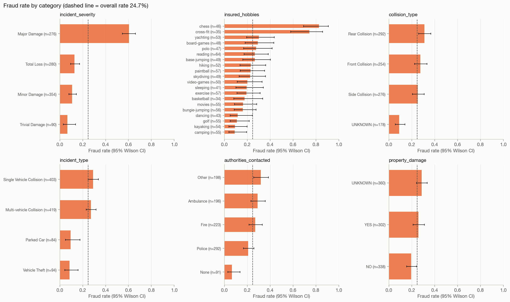

### Leakage audit of `total_claim_amount`

* `total_claim_amount` equals `injury_claim + property_claim + vehicle_claim` on **every** row
  (maximum absolute difference 0). It is therefore redundant and dropped; its information
  survives through the components and the engineered `log_total_claim`.
* The amounts are amounts **claimed** at filing time (fraudulent claims are not recorded with
  a zero payout), so they are not a post-investigation variable. Their univariate ROC-AUC is
  0.56–0.60, nowhere near the near-perfect separation a leaked target proxy would give.
* Ablation (5 × 5 CV, tuned CatBoost): all features 0.707 PR-AUC; adding the redundant total
  back 0.705; **removing every amount-derived feature 0.716**. The amounts add nothing, so they
  cannot be a leakage channel. They are kept for completeness.

### Feature engineering

All engineered features are row-wise and computed in the first step of every pipeline
([`src/features.py`](src/features.py)); identifiers (`policy_number`, `insured_zip`,
`incident_location`) are never model inputs.

| Feature | Why |
|---|---|
| `policy_tenure_days` | incident date − bind date; young policies are a classic fraud red flag and raw dates are unusable |
| `incident_weekday` | day-of-week effect; month/year are meaningless over a 2-month window |
| `csl_per_person`, `csl_per_accident` | `policy_csl = "250/500"` packs two numeric limits into a string |
| `vehicle_age` | more interpretable than the model year |
| `log_total_claim`, `injury_share`, `property_share` | right-skewed amounts and claim composition (vehicle share omitted: exact complement) |
| `claim_to_premium` | claim size relative to the premium paid |
| `has_umbrella` | 80 % of policies have no umbrella cover; helps linear models separate "none" from "amount" |

## Methodology

```text
                       data/insurance_claims.csv (1,000 claims)
                                     │  deterministic cleaning (no statistics learned)
                                     ▼
              stratified split ── test 200 (locked until the evaluate stage)
                                     │
                               train 800
                                     │
     ┌───────────────────────────────┼───────────────────────────────┐
     ▼                               ▼                               ▼
 Optuna, 40 trials per model     5×5 repeated stratified CV      generators fitted on
 same 5 folds, PR-AUC objective  (tuned params) → fold scores    these 800 rows only
 imbalance strategy searched     + out-of-fold probabilities     (synthetic stage)
     │                               │
     │                               ├─ cost-optimal threshold per model (OOF)
     │                               ├─ reference model = best mean CV PR-AUC
     │                               └─ corrected t-test between models (CV folds)
     ▼
 refit on the 800 claims ──► single evaluation on the 200 test claims
                             bootstrap CIs · paired bootstrap · McNemar · Holm
                             calibration · costs · SHAP · permutation importance
```

Every step that learns from data lives inside a scikit-learn / imbalanced-learn `Pipeline`
([`src/pipelines.py`](src/pipelines.py)): median imputation, standardisation, one-hot
encoding (levels with fewer than 10 occurrences in the training fold are pooled), SMOTE (applied
at fit time only), CatBoost's native categorical encoding, and the MLP's own imputation,
scaling and category maps. [`tests/test_leakage.py`](tests/test_leakage.py) checks that
fitted statistics equal the training-fold statistics, that unseen test categories are
handled, that SMOTE never runs at prediction time, and that the training stage never reads
test labels.

**Models** ([`src/models.py`](src/models.py)): logistic regression without penalty
(baseline, no hyper-parameters) and with elastic net; random forest; scikit-learn gradient
boosting; XGBoost; LightGBM; CatBoost; an MLP in PyTorch with entity embeddings, batch norm,
dropout, AdamW and early stopping on an inner validation split ([`src/nn.py`](src/nn.py));
and a stacking ensemble of the three best models (by CV) with a logistic meta-learner.

**Tuning**: Optuna TPE (seeded), 40 trials per tunable model, the same five folds for all,
objective = mean PR-AUC, median pruning, the default configuration enqueued as trial 0. The
imbalance strategy (none / class weights / SMOTE) is one of the searched hyper-parameters
where it applies.

**Business costs** (assumptions, configurable in [`configs/default.yaml`](configs/default.yaml)
or with `--cost-fn` / `--cost-investigation`):

| Outcome | Cost (USD) |
|---|---|
| claim flagged (true or false positive): investigation | 1,000 |
| fraud not flagged (false negative): paid out | 10,000 |
| legitimate claim not flagged | 0 |

With calibrated probabilities the optimal rule is "flag if P(fraud) > 1,000 / 10,000 = 0.10";
the pipeline instead picks, for each model, the threshold minimising the cost on its training
OOF predictions (CatBoost: 0.15).

## Results in detail

All files are in [`results/metrics`](results/metrics) and come from `make all`.

### Cross-validation

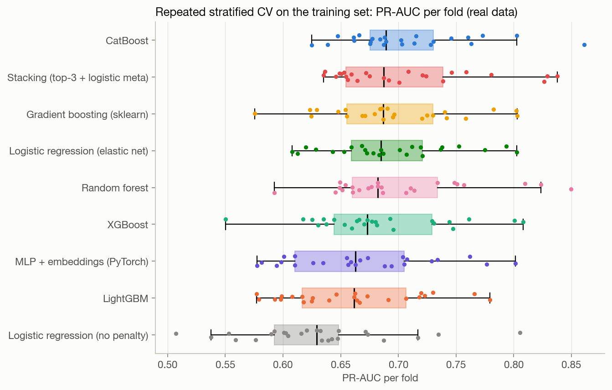

Fold-to-fold spread (sd ≈ 0.055) is about the size of the gap between the first and the
seventh model, which is why the corrected t-test finds no significant difference.

### Class imbalance strategies

Same tuned hyper-parameters, only the strategy changes (5 × 5 CV PR-AUC on the training split):

| Model | none | class weights | SMOTE | chosen by Optuna |
|---|---|---|---|---|
| Logistic regression (elastic net) | 0.687 | **0.693** | 0.682 | weights |
| Random forest | 0.685 | 0.682 | **0.701** | SMOTE |
| XGBoost | 0.659 | **0.683** | 0.666 | weights |
| LightGBM | 0.499 | 0.508 | **0.659** | SMOTE |

For three models the strategies are within one standard deviation of each other (≈ 0.05).
The LightGBM gap is not a pure imbalance effect: its tuned `min_child_samples = 48` is larger
than the 26–32 "chess" claims of a CV training fold, so without the extra minority rows
created by SMOTE the trees cannot isolate that level; the strategy interacts with the other
hyper-parameters. For the elastic-net logistic regression, re-weighting and SMOTE worsen
calibration (CV Brier 0.114 → 0.125 / 0.129) for no clear ranking gain; for the tree models
the Brier score barely moves ([full table](results/metrics/real_imbalance_strategies.csv)).

### Calibration

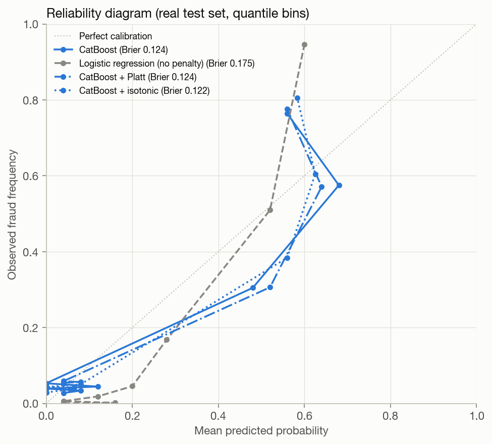

| CatBoost on the test set | Brier |
|---|---|
| uncalibrated | 0.124 |
| + Platt scaling (5-fold, train only) | 0.124 |
| + isotonic regression (5-fold, train only) | 0.122 |

The tree ensembles are already reasonably calibrated; recalibration brings no meaningful
gain on 200 test claims and is not used in the exported model.

### Decisions at the cost-optimal threshold

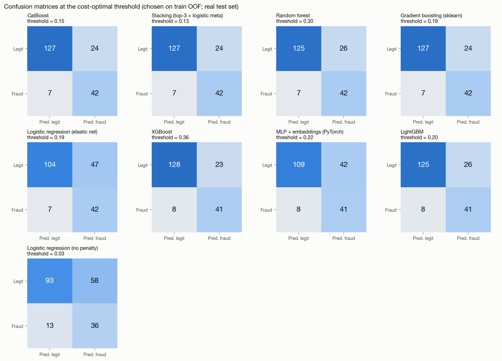

Sensitivity of the CatBoost policy to the cost ratio (threshold re-optimised on training OOF
for each ratio, cost measured on the test set):

| Missed fraud / investigation | 2 | 3 | 5 | 7.5 | 10 | 15 | 20 | 30 | 50 |
|---|---|---|---|---|---|---|---|---|---|
| threshold | 0.46 | 0.15 | 0.15 | 0.15 | 0.15 | 0.15 | 0.15 | 0.01 | 0.01 |
| savings vs best trivial policy | 12 % | 41 % | 50 % | 41 % | 32 % | 15 % | −3 % | 0 % | 0 % |

The model is worth deploying only for intermediate cost ratios: when a missed fraud costs 20
times an investigation or more, investigating everything is as good or better.

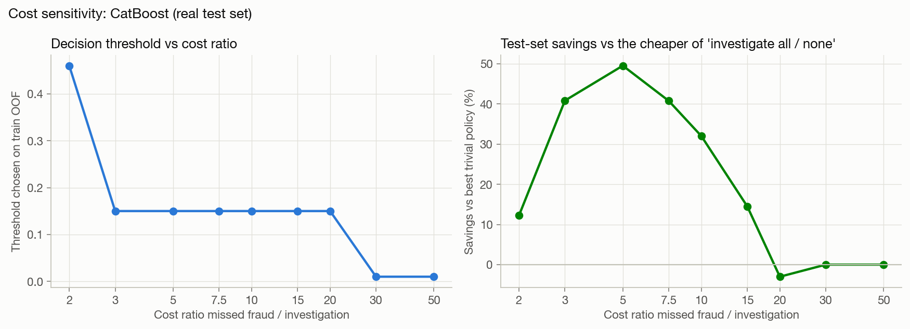

### Learning curves and neural-network training

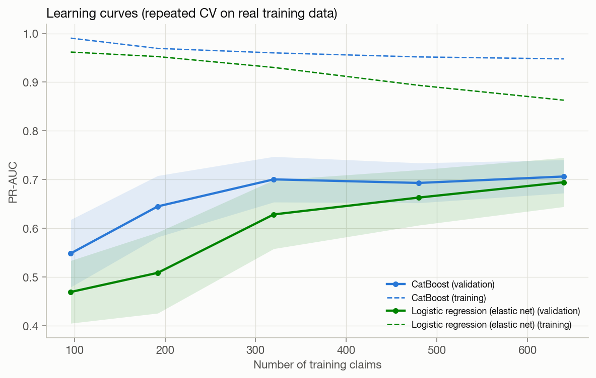

CatBoost plateaus from about 300 training claims while the elastic-net logistic regression is
still improving at 640: more real data would mainly help the simpler models.

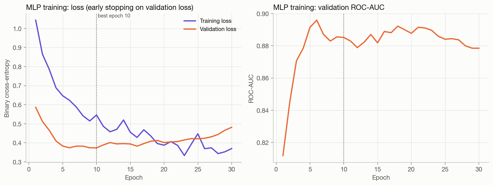

The final MLP (one hidden layer of 32 units, dropout 0.5, chosen by Optuna) reaches its best
validation loss after 10 epochs and overfits afterwards; early stopping restores that epoch.

## Synthetic data: scale and robustness only

> ⚠️ **Everything in this section is SYNTHETIC.** No number here is a measure of real-world
> fraud-detection performance. Synthetic files and figures carry the `SYNTHETIC` / `synthetic_`
> prefix.

Three generators were fitted on the **800 real training claims only**, so that the 200 real
test claims remain unseen and can be used for "train on synthetic, test on real" (TSTR):

* a **class-conditional Gaussian copula** written for this project
  ([`src/synthetic.py`](src/synthetic.py)): one copula per class (fraud rate reproduced
  exactly), empirical marginals, categorical levels mapped to frequency intervals;
* **SDV GaussianCopula** and **SDV CTGAN** (300 epochs).

The same business-rule correction (a collision type exists if and only if the incident is a
collision) is applied to every generator's output; the raw violation rate is reported.

| Quality check (20,000 rows per generator vs the 800 real training claims) | Custom copula | SDV GaussianCopula | SDV CTGAN |
|---|---|---|---|
| fraud rate (real: 0.248) | 0.248 | 0.243 | 0.329 |
| mean KS distance, numeric marginals (0 = identical) | **0.010** | 0.190 | 0.176 |
| mean total-variation distance, categorical marginals | **0.008** | 0.011 | 0.056 |
| mean abs. gap in Spearman correlations | **0.014** | 0.018 | 0.065 |
| mean abs. gap in Cramér's V (categoricals + target) | **0.085** | 0.100 | 0.107 |
| raw business-rule violations | 21 % | 32 % | 31 % |
| real-vs-synthetic detection ROC-AUC (0.5 = indistinguishable) | **0.83** | 1.00 | 1.00 |
| exact copies of real rows | 0 | 0 | 0 |
| distance to closest real record, ratio to real hold-out | 1.01 | 1.05 | 1.06 |
| TSTR: LightGBM on 20,000 synthetic rows → real test PR-AUC | **0.537** | 0.423 | 0.232 |
| TSTR: same, ROC-AUC | **0.831** | 0.716 | 0.436 |
| TRTR reference: same LightGBM on the 800 real rows → real test | 0.520 / 0.830 | | |

* The custom copula is the best generator on every check and was selected for the large
  dataset on the **detection AUC, a criterion computed against the training split only** (the
  real test split plays no role in the choice). With 800 rows, CTGAN does not learn the joint
  distribution (it even shifts the fraud rate to 33 %), and SDV's parametric marginals fit the
  heavily discrete numeric columns badly.
* Even the best generator remains **detectable** (AUC 0.83): matching marginals and pairwise
  correlations does not reproduce higher-order structure, such as the mixture of small theft
  claims and large collision claims.
* **Privacy**: no real row is copied, and synthetic rows are as far from the training claims
  as genuinely new real claims are (distance ratio 1.01; 4 % of synthetic rows fall below the
  5th percentile of real hold-out distances, close to the 5 % expected by chance).
* **TSTR ≈ TRTR**: a model trained on 20,000 synthetic claims scores 0.537 PR-AUC on the real
  test set, against 0.520 for the same model trained on the 800 real claims, a difference well
  inside the ±0.1 test-set uncertainty. The generator preserves the signal; it does not add any.

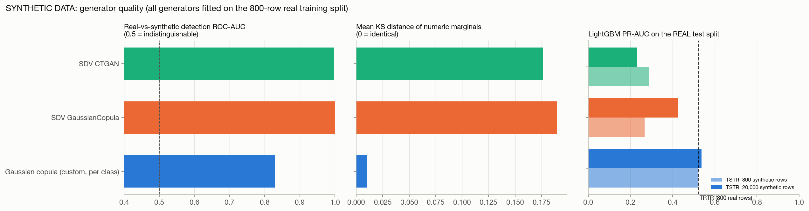

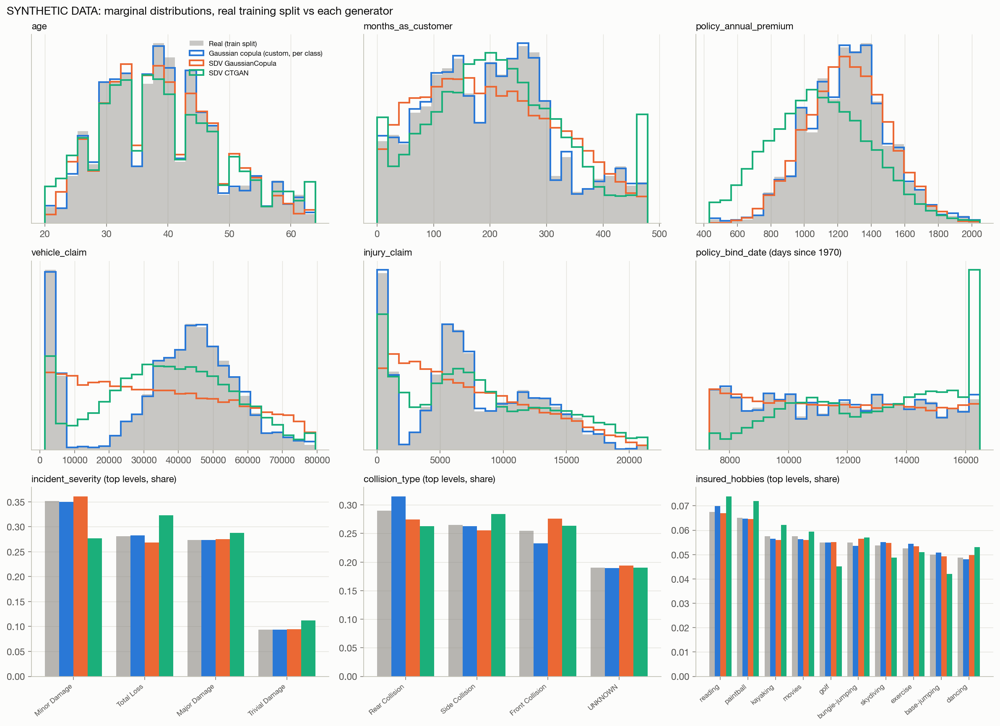

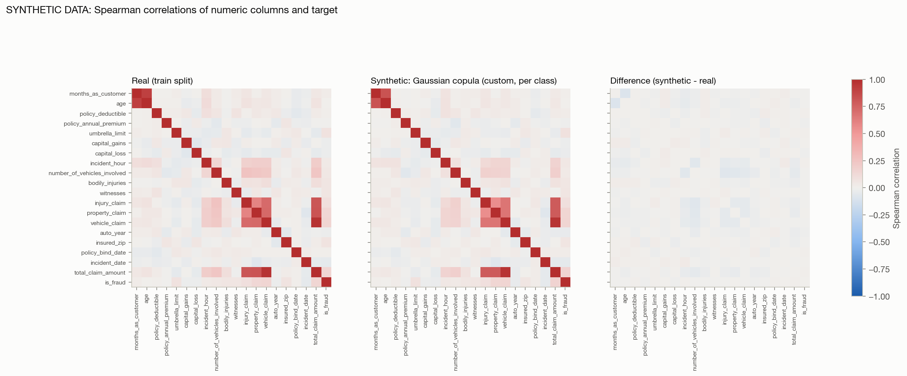

### Large synthetic dataset and scale benchmark

`make synth` writes `data/synthetic/SYNTHETIC_claims_gaussian_copula_custom_500000.parquet`
(500,000 rows, same 39-column schema, fraud rate 24.75 %, 23 MB, git-ignored) plus a
versioned 1,000-row sample. Each model is retrained with its real-data hyper-parameters on
1k → 500k synthetic rows and scored on a 50,000-row **synthetic** hold-out and on the 200
**real** test claims:

| Model (real-data hyper-parameters) | Fit time at 500k | PR-AUC, synthetic hold-out (1k → 500k) | PR-AUC, real test / TSTR (1k → 500k) |
|---|---|---|---|
| CatBoost | 255 s | 0.822 → 0.928 | 0.533 → 0.495 |
| MLP + embeddings | 37 s | 0.782 → 0.904 | 0.485 → 0.466 |
| LightGBM | 113 s | 0.803 → 0.862 | 0.549 → 0.524 |
| XGBoost | 39 s | 0.786 → 0.837 | 0.503 → 0.527 |
| Logistic regression (elastic net) | 477 s | 0.764 → 0.835 | 0.473 → 0.508 |
| Random forest (capped at 100k) | 896 s at 100k | 0.742 → 0.861 | 0.610 → 0.566 |
| Gradient boosting (capped at 100k) | 164 s at 100k | 0.772 → 0.800 | 0.590 → 0.533 |

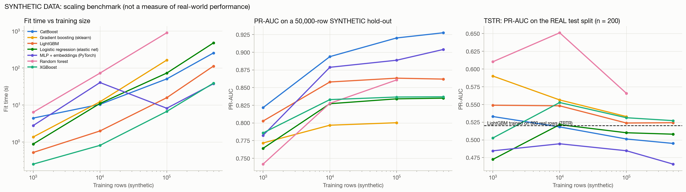

* **Engineering view**: XGBoost and the MLP train on 500,000 claims in under 40 s on a laptop
  CPU, LightGBM in 2 min, CatBoost in 4 min; the saga solver of the elastic-net regression is
  the slowest scalable model (8 min). scikit-learn's random forest (800 deep trees + SMOTE)
  and gradient boosting were capped at 100,000 rows because they scale poorly.
* **Statistical view**: on the synthetic hold-out every model improves with more rows and the
  scores (0.80–0.93) are far above anything achievable on real claims. On the **real** test
  claims, more synthetic data does **not** help: changes between 1k and 500k rows range from
  −0.04 to +0.035, all inside the ±0.1 test-set uncertainty, and the most flexible models
  (CatBoost, MLP) drift down as they learn the generator's own regularities. The synthetic task is
  easier than the real one, which is precisely why synthetic scores must never be reported as
  performance.
* Deviations from the real-data setup, needed to keep fits tractable: on more than 10,000 rows
  the MLP uses batches of 1,024 and at most 30 epochs (patience 4); no re-tuning was done on
  synthetic data.

## Interpretation

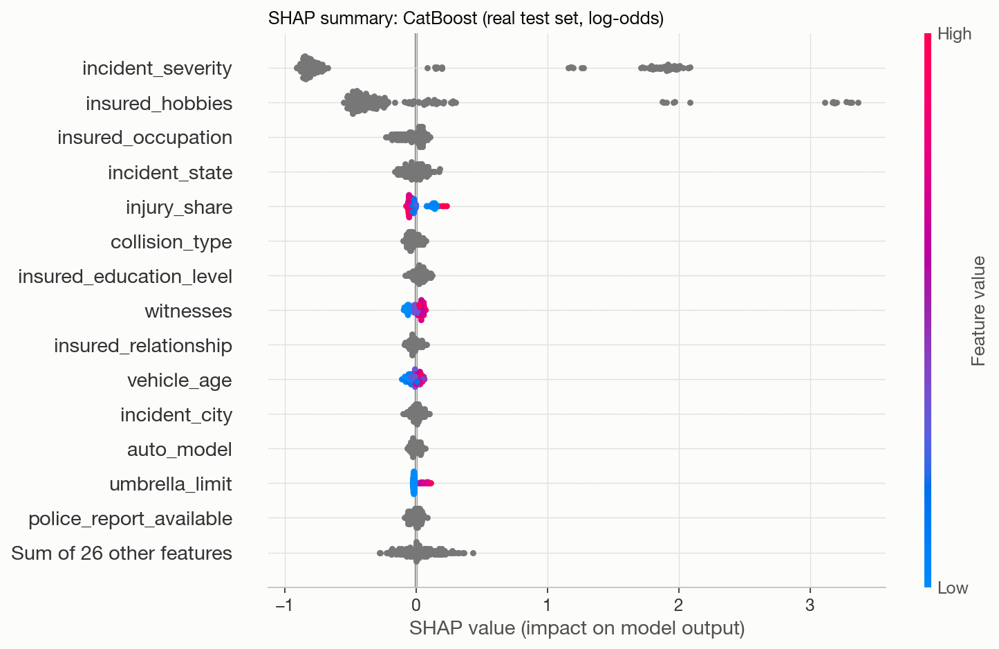

SHAP values of the reference CatBoost model on the test claims (log-odds scale), confirmed by
permutation importance on the same claims (drop in PR-AUC when a column is shuffled:
`incident_severity` 0.23, `insured_hobbies` 0.14, every other column < 0.01):

* **`incident_severity`** is the dominant driver: *Major Damage* claims carry ~60 % fraud in
  the data versus 7–13 % for other severities, and the model raises their log-odds by about +2.
  A plausible business reading is that large-damage claims are where inflating a claim pays,
  but the data cannot tell inflation from genuine severe accidents.
* **`insured_hobbies`** in {chess, cross-fit} (83 % and 74 % fraud) is the second driver.
  There is no credible causal mechanism for this; it is almost certainly an artefact of how
  this public dataset was produced. A model deployed on real portfolio data should not be
  expected to find it, and a production model should probably exclude such variables for
  fairness and robustness reasons.
* Everything else (injury share of the claim, witnesses, vehicle age, occupation, state)
  contributes an order of magnitude less.

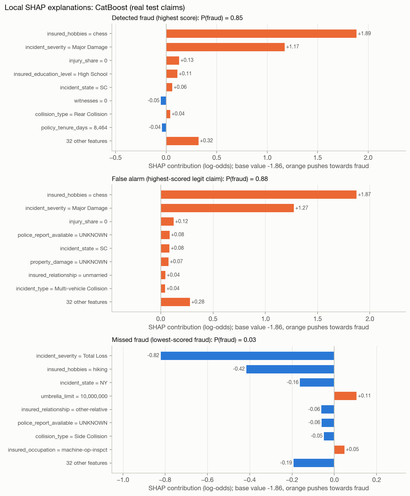

The local explanations make the dependence visible: the highest-scored fraud and the
highest-scored **false alarm** are explained by exactly the same two factors (hobby + major
damage), and the missed fraud is a *Minor Damage* claim with an ordinary hobby. SHAP describes
the model, not the world: none of these attributions is a causal statement.

Additional figures: [SHAP dependence](results/figures/real_shap_dependence.png),
[permutation importance](results/figures/real_permutation_importance.png),
[EDA distributions](results/figures/eda_numeric_distributions.png),
[correlation matrix](results/figures/eda_correlation_matrix.png),
[data quality](results/figures/eda_data_quality.png).

## Limitations and honest notes

* **Small real dataset.** 800 training and 200 test claims (49 test frauds). Test metrics carry
  ±0.1 uncertainty on PR-AUC; model rankings inside the top group are not reliable.
* **Questionable realism of the benchmark.** The dataset's provenance is undocumented and
  the hobby effect suggests it is partly simulated. Results describe this benchmark, not real
  insurance portfolios.
* **Synthetic data adds no information.** Generators learned from 800 rows reproduce (part of)
  what is in those 800 rows. Synthetic scores are reported separately and are never a measure
  of real performance; models trained on synthetic data score no better on real claims than
  models trained on the 800 real ones, however many synthetic rows they see.
* **Cost hypotheses are assumptions.** 1,000 USD per investigation and 10,000 USD per missed
  fraud are illustrative round numbers, not insurer data; the sensitivity table shows how much
  the conclusion depends on them. The model also ignores claim-specific amounts at risk.
* **Selection on CV, single test evaluation.** The reference model was chosen on CV before the
  test set was opened, but the 2–4 % differences between the top models mean another seed
  could rank them differently.
* **Fraud labels.** `fraud_reported` is the outcome of an investigation process we know nothing
  about; label noise and selection bias (which claims were investigated) are unknown.
* **No production validation.** No temporal validation (incidents span two months), no drift
  monitoring, no fairness audit (sex, education and occupation are inputs), no latency or load
  testing of the API beyond the unit tests.
* **Budget.** 40 Optuna trials per model on a 6-core laptop CPU. A larger budget might move
  individual models by a few points; it would not change the conclusion that they are
  statistically indistinguishable on this data.

## Reproduce

```bash
git clone https://github.com/fleury-fcn/prediction-sinistres-machine-learning-.git
cd prediction-sinistres-machine-learning-
python3.12 -m venv .venv && source .venv/bin/activate
make install          # pinned requirements (Python 3.12)
make all              # eda → train → evaluate → synth, then executes the notebooks
make test lint        # 43 unit tests, ruff + black
```

* `python -m src.main --stage {eda,train,evaluate,synth,all} [--fast]`; `--fast` runs the
  whole pipeline with tiny budgets in a few minutes (smoke test only, never for reporting).
* `--cost-fn 20000 --cost-investigation 500` re-runs the cost analysis with other hypotheses;
  `--synthetic-rows 1000000` changes the size of the synthetic dataset.
* Seeds are fixed (`seed: 42` in `configs/default.yaml`); the full run took about 1 h 40 min on
  an Intel Core i7-9750H (6 cores). Runs are also logged to a local MLflow store (`mlruns/`,
  `mlflow ui`), while the versioned source of truth is `results/metrics/`.
* macOS note: PyTorch ships its own OpenMP runtime, which deadlocks with the one used by
  LightGBM/XGBoost when both run multi-threaded in one process. The code therefore pins torch
  to one thread and never imports it before the boosting libraries.

## Repository structure

```text
├── configs/default.yaml        seeds, CV, Optuna budget, costs, synthetic sizes (+ fast overrides)
├── data/
│   ├── insurance_claims.csv    real benchmark (1,000 claims)
│   └── synthetic/              SYNTHETIC_sample_1000.csv (versioned); 500k parquet regenerated
├── src/
│   ├── config.py               paths, column schema (RENAME_MAP), settings loader
│   ├── data.py                 loading, deterministic cleaning, split
│   ├── features.py             stateless feature builder
│   ├── pipelines.py            leak-free preprocessing (+ SMOTE)
│   ├── models.py               model registry and Optuna search spaces
│   ├── nn.py                   PyTorch tabular MLP (sklearn API)
│   ├── training.py             Optuna tuning, repeated CV
│   ├── evaluation.py           metrics, bootstrap, costs, statistical tests
│   ├── interpret.py            SHAP, permutation importance
│   ├── synthetic.py            generators and quality checks
│   ├── plots.py                figure style and helpers
│   ├── stages/                 eda, train, evaluate, synth
│   └── main.py                 CLI
├── notebooks/                  01_eda.ipynb, 02_results.ipynb (executed, outputs visible)
├── results/
│   ├── figures/                every figure shown here
│   ├── metrics/                every number shown here (CSV / JSON / Markdown)
│   └── models/                 exported CatBoost pipeline + model card
├── api/app.py                  FastAPI service      ├── streamlit_app.py   demo app
├── tests/                      pytest suite         ├── Dockerfile         API image
└── Makefile, pyproject.toml, requirements*.txt, .github/workflows/ci.yml
```

## Serving the model

```bash
make api                                   # uvicorn on :8000
curl localhost:8000/health
curl -X POST localhost:8000/predict -H "Content-Type: application/json" -d @examples/claim.json
# {"fraud_probability": …, "flag_for_investigation": …, "decision_threshold": 0.15, "model": "CatBoost"}

make docker-build docker-run               # same API in a slim image (no torch)
make app                                   # Streamlit demo: score a claim, browse results
```

The exported model is the best-CV model that does not need PyTorch at inference time
(CatBoost here), saved with a [model card](results/models/model_card.json) containing its
parameters, threshold, cost hypotheses and CV/test metrics.

## Next steps

* Validate on a real, larger and time-stamped claims portfolio (temporal split, drift checks).
* Example-dependent costs (amount at risk per claim) instead of a flat missed-fraud cost.
* Fairness audit and a variant without protected or spurious attributes (sex, hobbies).
* Conformal prediction or Venn–Abers calibration to give investigators per-claim uncertainty.
* Try FT-Transformer / TabNet only once more real data is available.

## Suggested GitHub metadata

* **Description:** Leak-free insurance fraud detection benchmark: 9 models tuned with equal
  Optuna budgets, repeated CV, bootstrap CIs, cost-based thresholds, SHAP, synthetic-data
  scale tests, FastAPI.
* **Topics:** `machine-learning`, `fraud-detection`, `insurance`, `actuarial-science`,
  `imbalanced-learning`, `catboost`, `xgboost`, `lightgbm`, `pytorch`, `optuna`, `shap`,
  `synthetic-data`, `scikit-learn`, `fastapi`, `model-evaluation`

## Author

**Fleury Niyokwizera** · Master 1 MIASHS (Data Modeling, AI track), Université de Lille ·
[LinkedIn](https://www.linkedin.com/in/fleury-niyokwizera-2a9436291/)
